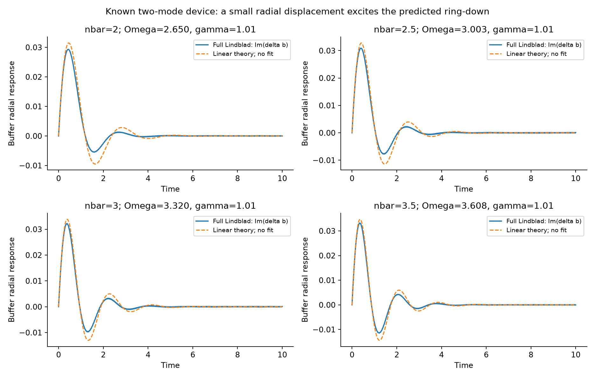
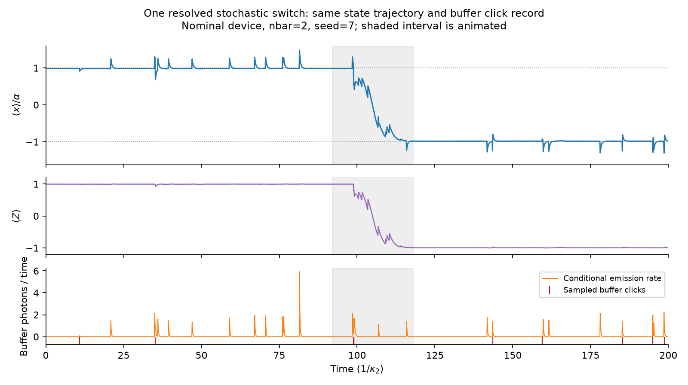
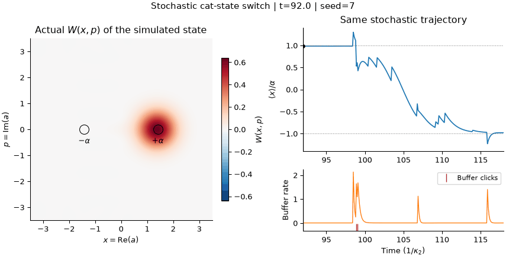
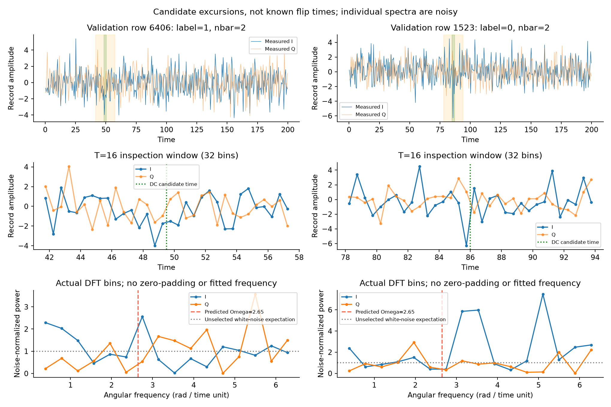
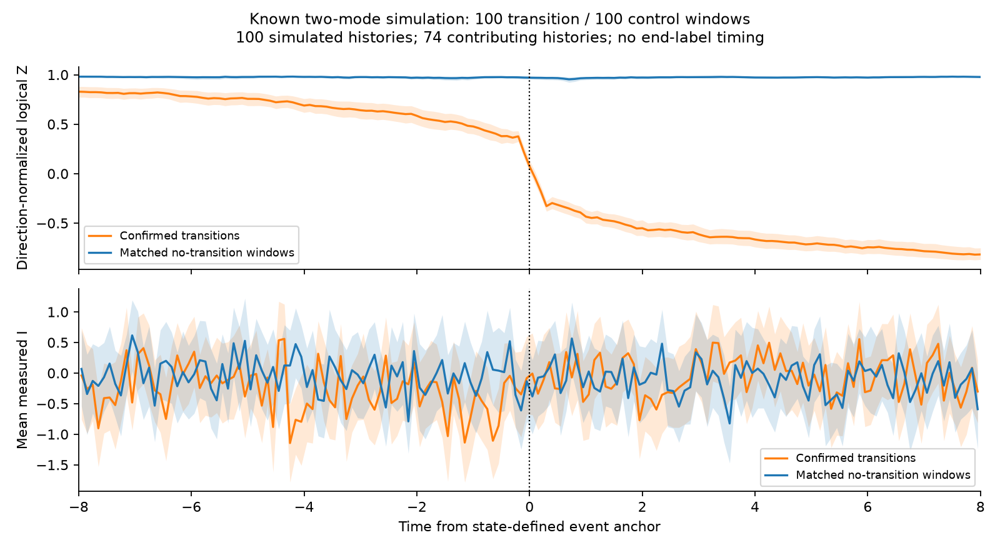
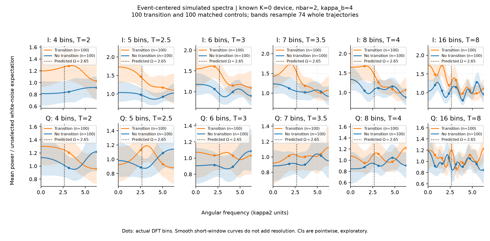
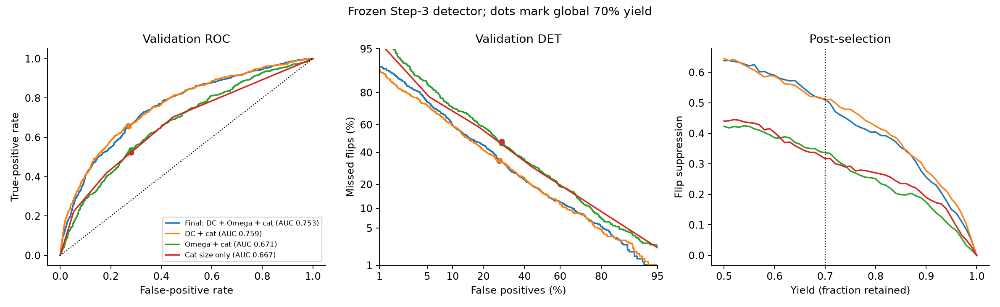

# Cat-state bit-flip detector

**Can the relaxation modes of a dissipative cat qubit help us detect its bit flips?**
I derive a buffer-response frequency, look for its signatures in noisy measurement
records, and test a simple signed-DC + Fourier score against labelled trajectories.
This repository is based on my submitted Step-3 solution at **PushQuantum Hackathon
2026**, with team **"Cube it - Alice!"**, and is presented here as a plain Python project.

Start with my derivation of the response frequency $\Omega$ and amplitude $G_s$: **[Almost Linear Response Theory Model (PDF)](docs/AlmostLinearResponseTheoryModel.pdf)**.
The [original presentation](docs/Cube%20it%20Alice%20CatchTheFlip%20%281%29.pdf) and
[submitted results](docs/submitted_results.md) are also retained unchanged.

## The physical idea

The memory stores logical states near $|+\alpha\rangle$ and $|-\alpha\rangle$,
with cat size $\bar n=\alpha^2$. Both are dark to the engineered two-photon loss:
$a^2|\pm\alpha\rangle=\alpha^2|\pm\alpha\rangle$. Excursions out of this code
space drive a lossy buffer, whose emitted field can reveal a disturbance.
Not every disturbance completes a logical flip: a true logical flip is described by the $|+\alpha\rangle \mapsto |-\alpha\rangle$ transition.

For memory $a$ and buffer $b$, the model is

$$
H=g_2(a^2b^\dagger+a^{\dagger2}b)-\varepsilon_d(b+b^\dagger)
-\frac K2a^{\dagger2}a^2,\qquad
\dot\rho=-i[H,\rho]+\sum_j\mathcal D[L_j]\rho,
$$

with $L_b=i\sqrt{\kappa_b}b$, memory loss/thermal/dephasing channels, and
$\varepsilon_d=g_2\alpha^2$. My $K=0$ linearization about $a=s\alpha+\delta a$
gives local first-moment eigenvalues

$$
\boxed{\lambda_\pm=-\gamma\pm i\Omega,\quad
\gamma=\frac{\kappa_b+\kappa_1+\kappa_\phi}{4},\quad
\Omega^2=4g_2^2\bar n-
\frac{(\kappa_b-\kappa_1-\kappa_\phi)^2}{16},}
$$
where the most important result is the response frequency $\Omega$. The detector function will be built around inspecting the quadrature Fourier amplitude at this frequency.

A small inward radial displacement $d$ produces
$\delta\langle b(t)\rangle=i(G_s d/\Omega)e^{-\gamma t}\sin(\Omega t)$, where $G_s=2sg_2\alpha$.
The imaginary buffer response appears in $I(t)$; a radial excursion can also produce a negative $I$-pulse, motivating the **zeroth mode**. These are local relaxation modes, not the much slower logical-flip rate $\Gamma_Z$.



This controlled full-Lindblad calculation checks the proposed ring-down against a known two-mode device, rather than fitting a sinusoid to whichever data look oscillatory. Finite-cat nonlinear dynamics produce visible deviations from the linear approximation; numerical relative RMS errors are saved with the plot.

## A stochastic flip in phase space

The plot and animation below follow **the same simulated trajectory**, from the
$+\alpha$ lobe to the $-\alpha$ lobe, with the buffer clicks sampled in that run.
The shaded interval in the full trace is the interval animated below; the moving
cursor synchronizes the state, Wigner function, and photon-emission record.





This is a known nominal-device example (`nbar=2`, seed 7), selected to illustrate
one resolved flip, not to estimate a flip rate or prove the frequency claim.
The Wigner frames are calculated from the actual saved quantum state: they can
split and develop interference fringes rather than remain a rigid Gaussian blob.
For a localized full-state trajectory, this visualization uses an equivalent
displaced-counting measurement of the normally unobserved memory-loss output;
the underlying Lindblad generator and buffer-counting channel are unchanged.
The full state is privileged simulator information, not something recoverable
from buffer clicks alone; see [measurement choice and reproduction details](docs/wigner_demo.md).
Regenerate just these figures with `uv run python main.py --wigner-only`
(or `uv run --extra cuda python main.py --wigner-only` for the GPU environment).

## What the records show

The supplied records are **physics-based stochastic simulations**, not laboratory
data. In the original illustrated flip-labelled segment, a local 32-bin spectrum
has elevated I power near predicted $\Omega$; the no-flip control is weaker there.
The green event time below is selected by an I dip: **the dataset does not provide
the actual flip time**. The examples are illustrative, not a significance test.



### Spectra at state-timed transitions

Final readout labels cannot locate flips within the supplied records, so the
spectra below use a **separate, known two-mode simulation**: 100 trajectories of
800 time units at $\bar n=2$, $\kappa_b=4$, $K=0$, with ideal buffer detection.
Transitions are defined using the simulated $\langle Z\rangle$, never I/Q power:
opposite $|\langle Z\rangle|\geq0.8$ plateaus must each last at least one time unit.
Between them, the largest directed Z change over 0.5 units sets the window center.
This is an operational state-based timing rule, not an experimental timestamp.



We take **100 isolated transition windows and 100 matched no-transition windows**
from 74 contributing histories, cycling through trajectory IDs before reusing a
history. Controls come from the same history and starting logical side; neither
cohort is filtered for an attractive I/Q waveform. Only Z is direction-normalized
in the alignment plot; the measured quadratures are not sign-flipped.



Each curve averages **local spectra around the selected moments**, not spectra of entire flip-labelled trajectories. Fixed 3-, 4- and 16-bin windows use the challenge bin width 0.5; their means are subtracted before Fourier projection.
The dotted vertical line marks **predicted $\Omega=2.65$ on the frequency axis**;
the y-axis is power, so a horizontal line at Omega would mix different units.
Dots mark actual DFT bins: a smooth projection curve does not create frequency resolution from three or four samples. Bands are pointwise 95% paired bootstrap intervals, resampling whole contributing histories (2,000 resamples), including all event/control pairs from a resampled history together.

At the characteristic frequency $\Omega$ one can see that yes-flip events have higher Fourier amplitude than no-flip events.
This is the key evidence for the amplitude being a reasonable herald of flip events.
Moreover, for the time windows of the time length $\approx 2\pi / \Omega$
 we get that the Fourier amplitude at $\Omega$ is the highest amplitude in the spectrum!

Replot the bundled measured windows with `uv run python main.py --event-study`.
To regenerate all histories, use `uv run --extra cuda python main.py --resimulate-events`
(or omit `--extra cuda` for CPU). The documented double-precision CPU run took
18.4 minutes; plotting the bundled windows takes seconds. Parameters, selection
rules, limitations and saved arrays are described in [the event-study notes](docs/event_study.md);
[all numerical spectra and intervals](outputs/simulated_event_study.json) are retained.

## The submitted detector

For a gliding window of $L=4$ bins, $\Delta t=0.5$, $T=L\Delta t=2$, advancing
one bin at a time, compute

$$
D=\max_m\sqrt T\left[I_{\mathrm{base}}(\bar n)
-\frac1L\sum_{r=0}^{L-1}I_{m+r}\right],\qquad
F=\max_m T\left|\frac1L\sum_{r=0}^{L-1}
I_{m+r}e^{-i\Omega r\Delta t}\right|^2.
$$

**D** is the strongest downward local mean; **F** is the strongest oscillatory
projection at the predicted frequency. Their maxima need not occur in the same
window. The original score uses raw I for F, so finite-window DC leakage remains;
the PDF's last paragraph describes an earlier, demeaned variant.

For $X\in\{D,F\}$, form robust training z-scores separately by cat size:

$$
z_X=\frac{X-\mathrm{median}_{\rm train}(X\mid\bar n)}
{\mathrm{IQR}_{\rm train}(X\mid\bar n)/1.349},\qquad
z_C=\frac{-\bar n-\mathrm{mean}_{\rm train}(-\bar n)}
{\mathrm{std}_{\rm train}(-\bar n)}.
$$

The final function is **[my_detector(nbar, I, Q, calibration)](src/catflip/detector.py)**:

$$\boxed{S=\frac{z_D+z_F}{2}+z_C.}$$

Higher S means more suspicious, not a calibrated flip probability; Q is unused.
We retain the lowest-scoring **70% globally**, across all cat sizes.
The 22 calibration statistics (four baselines, sixteen D/F centers/scales, two
cat-score statistics) come from 10,500 training rows, using a seed-2026
cat/label-stratified split; 4,500 training rows are held out. The original
training comparison covered T=2 versus T=8, DC/F/both, and cat weight 0 or 1;
this repository freezes the submitted F-containing recipe instead of tuning again.
No physical rates, frequencies, continuous mixture weights, classifier, or
per-cat label-derived flip probabilities were fitted.

The reference values are $\kappa_b=4$, $\kappa_2=1$,
$\kappa_1=\kappa_\phi=0.02$, hence $g_2=1$ and $\gamma=1.01$.
**Buffer decay 4 comes from the tutorial example, not hidden-device inference.**
Four bins cover only about one cycle: F is a short oscillatory filter, not a
well-resolved frequency measurement. Longer windows improve spectral resolution
but can dilute a transient; the longer diagnostic spectrum does not alter S.

## Detection results

Suppression is $1-p_{\rm kept}/p_{\rm all}$ at 70% yield, not classification
accuracy or the fraction of flips caught. Random discarding catches 30% of flips
on average and gives zero suppression.

| Validation detector | ROC AUC | Suppression | Flips caught |
|---|---:|---:|---:|
| Cat size only | 0.667 | 31.7% | 52.2% |
| DC + cat | 0.759 | 50.8% | 65.5% |
| Omega + cat | 0.671 | 33.7% | 53.6% |
| **Submitted DC + Omega + cat** | **0.753** | **51.2%** | **65.9%** |



The combined score improves suppression over cat size alone by **19.5 percentage
points**; within-cat AUCs range from 0.581 to 0.723. Held-out training gives AUC
0.790 and suppression 61.8%. Adding F over DC + cat improves validation suppression
by only **0.5 percentage points** and slightly lowers AUC, so a reliable incremental
Fourier benefit is not established. Validation was inspected during development;
it is not a pristine final test. See [per-cat curves](figures/per_cat.png) and
[machine-readable results](outputs/metrics.json).

The reported hidden-test leaderboard result was **0.47 suppression, or 6.8/10
points**. The hidden device has a finite-bandwidth buffer and small Kerr term,
while the training device is single-mode; its noise rates remain nominal.
Unknown buffer/coupling parameters, nonlinear flip excursions and noise can
limit a K=0, single-frequency reference detector. These are plausible limitations,
not a proven causal explanation of the score. A narrow frequency tolerance
around the prediction would be a reasonable future experiment with independent
calibration; it is **not** part of the submitted detector or a fitted result here.

## Challenge task and data

The task retained here is only **heterodyne bit-flip detection**: one score per
segment from I(t), Q(t), and known cat size. The nominal device supplies labelled
training records; validation belongs to a hidden device; test labels remain
private. Every segment starts at $|+\alpha\rangle$, lasts 200 time units and ends
with a Z readout; label 1 means that readout gave $-\alpha$.

The rules require a CSV `segment_id,score,decision`, one row per test segment in
original order, finite scores, binary decisions (1=discard), and a file below 2 MB. The leaderboard
discards the globally highest 30% of scores, regardless of per-cat proportions,
and scores only Tier B. The final entry is the last submitted file, not the best
historical upload. Hidden labels, device parameters and seeds must not be
reconstructed or inferred by leaderboard probing. Published test uncertainty is
about +/-0.015; differences below 0.03 are not meaningful distinctions. Points
increase linearly from zero at 0.30 suppression to ten at 0.55, with clipping.
This project never connects to the leaderboard or uploads a submission.

All six **Tier A and B** archives are in [data/](data/README.md), with schemas,
split sizes, physical units, provenance, checksums and MIT attribution. Tier A
is a separate photon-counting experiment for visual context, not an aligned
click stream of the Tier B trajectories.

## Run as a normal Python project

Use Python 3.13 and [uv](https://docs.astral.sh/uv/) (or install the project with
`python -m pip install -e .` in a virtual environment):

```bash
uv sync
uv run python main.py                    # simulations, diagnostics, evaluation
uv run python main.py --skip-simulations # supplied-data analysis only
uv run python main.py --skip-simulations --export-test # local CSV only
uv run python -m unittest discover -s tests
```

For a supported NVIDIA GPU on Linux, use the optional CUDA 13 installation
(driver >=580 and compute capability >=7.5; see the
[JAX installation guide](https://docs.jax.dev/en/latest/installation.html#nvidia-gpu)):

```bash
uv sync --extra cuda
uv run --extra cuda python main.py
uv run --extra cuda python -c "import jax; print(jax.devices())"
```

Keep `--extra cuda` when syncing the GPU environment; plain `uv sync` installs
the default CPU dependencies. VS Code uses the installed environment directly.
CUDA accelerates the JAX/Dynamiqs simulations; the NumPy detector runs on CPU.

Open this folder in VS Code and select `.venv/bin/python`; F5 runs `main.py`.
There are no notebooks, Marimo dependency headers, cloud credentials, or
automatic data downloads. Figures are saved to `figures/`, numerical results
and simulated states to `outputs/`. No GPU is required; the reference full CPU
run took about two minutes, excluding the first dependency download.

The full demo adds a nominal-device flip/no-flip **photon-counting** pair with full
rho(t), a(t), logical Z, ideal mean quadratures and channel-resolved clicks;
and an independent **heterodyne** pair with noisy I,Q and buffer-conditioned
rho(t), whose final labels are sampled using the Born rule. Full counting states
are privileged simulator information; ideal means are not an additional
simultaneous heterodyne measurement. Stochastic examples are deliberately
selected for illustration, with seeds and selection criteria saved, and are not
used to tune or evaluate the detector. The illustrative counting and heterodyne
cutoffs are N=24 (the controlled two-mode response uses Na=20, Nb=5), with no claim of a converged
flip-rate measurement. Searches are bounded to 32 seeds and fail explicitly if
no suitable pair is found. The original helper simulation, model and Liouvillian
code remains available in `src/catchtheflip/`. The simulator's `iL` channel gives
Q the opposite phase convention to the PDF; I and the submitted score are unaffected.
View the [counting simulation](figures/counting_simulations.png),
[heterodyne simulation](figures/heterodyne_simulations.png), and
[published click-record examples](figures/click_examples.png).

## Attribution and license

My contribution is the response theory and its Step-3 detector implementation
and interpretation; Alice & Bob supplied the challenge models, simulation helpers
and datasets. New project code is [MIT licensed](LICENSE), with the upstream
[Alice & Bob MIT notice](src/catchtheflip/LICENSE) stored beside the copied helper code,
with its scope explained in [that folder](src/catchtheflip/README.md).
The supplied PDFs retain the team's original attribution. See
[THIRD_PARTY.md](THIRD_PARTY.md) for exact sources and licensing boundaries.
